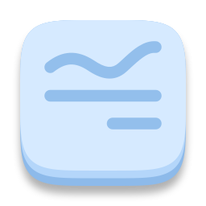
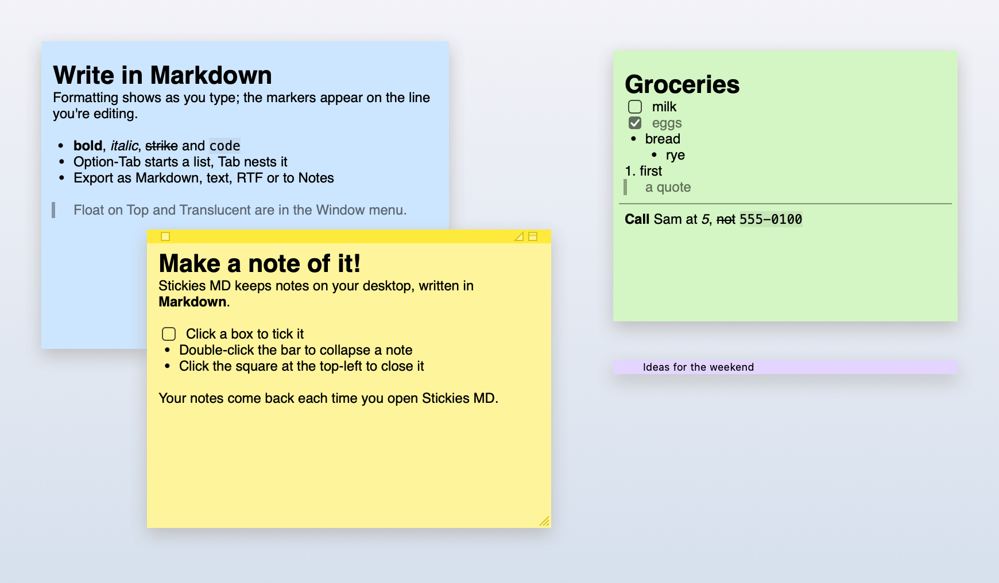

<p align="center"></p>

# Stickies MD

Apple's Stickies, but you write in Markdown.



It looks and behaves like Stickies: small colored notes that sit on your desktop, float on top or fold up into a bar. The difference is that you write in Markdown, it formats as you type, and every note is saved as a plain `.md` file. It doesn't do pictures, text colors or sync.

## Install

Get the zip for your Mac (Apple silicon or Intel) from [Releases](https://github.com/odeinjul/stickies-reproduced/releases), unzip it and drag the app to Applications. You need macOS 13 or later.

The app isn't notarized, so macOS stops it the first time. On macOS 15, click Done, then go to System Settings → Privacy & Security and click Open Anyway. On older versions, right-click the app and choose Open.

## Build

You need Swift (Xcode, or the Command Line Tools). Then:

```sh
make run     # build the app and open it
make test    # run the tests (needs Xcode)
```

[docs/SPEC.md](docs/SPEC.md) explains how it matches Stickies.

MIT licensed. Not affiliated with Apple.
